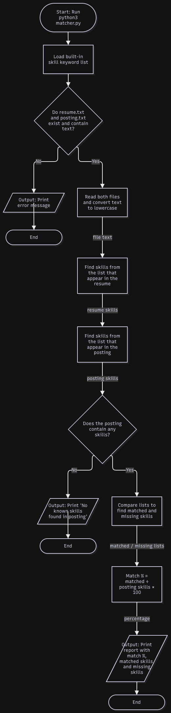

# Resume Matcher

## Project Goal
Students applying to internships tailor their resumes for every posting but have no quick way to see which skills a job asks for that their resume is missing. Resume Matcher is a Python command-line tool that compares a resume to a job posting and shows a match percentage and the missing skills, so students can fix real gaps before applicant tracking systems filter them out.

## MVP Scope
Version 1.0 will:
- Read a resume and a job posting from two text files
- Check both against a built-in list of common tech skills (case-insensitive)
- Find the skills that appear in the posting but not in the resume
- Calculate and print a match percentage
- Print a clear error message if a file is missing or empty

## Future Plans (V2.0+)
- Application tracker that saves company, role, deadline, status, and match score to a file
- Synonym handling (e.g., "JS" matches "JavaScript")
- Custom keyword list loaded from a separate file
- Compare one resume against several postings and rank them
- Save results to a report file
- Group missing skills by category (languages, tools, frameworks)

## Tech Stack
- **Language:** Python 3
- **Libraries:** Python standard library only (`os`); no external packages for the MVP
- **Data storage:** Plain text files (`resume.txt`, `posting.txt`); skill list stored in the program
- **Data sources:** None; all input comes from local files
- **Tools:** VS Code, Git, GitHub, terminal

## Planning Documents
- [Eisenhower Matrix](docs/eisenhower_matrix.pdf)
- System Diagram:



## How to Run
```bash
python3 matcher.py
```
(Usage details will be added as the project is built.)
